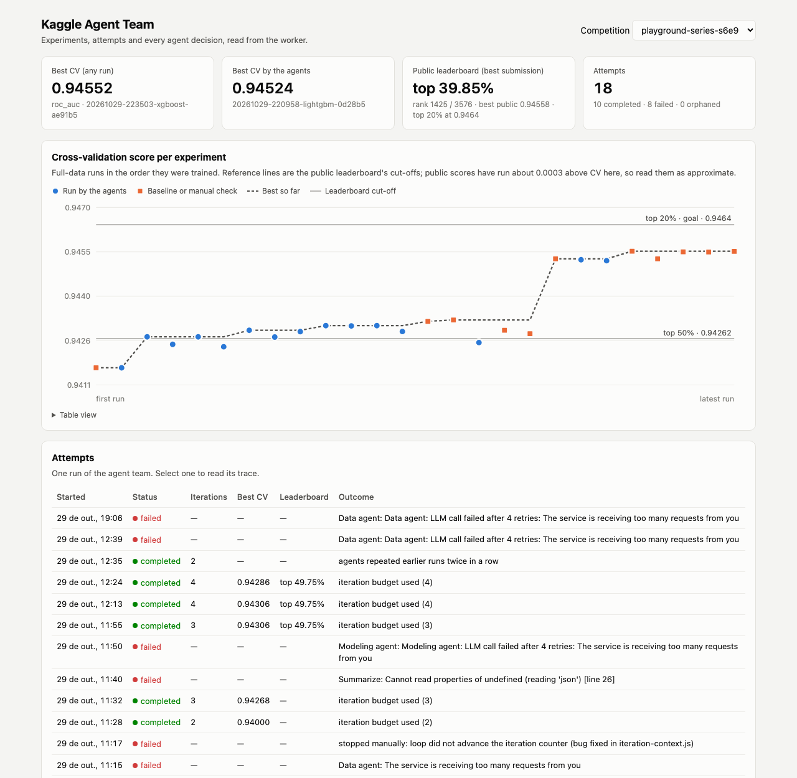

# Kaggle Multi-Agent Team (n8n)

A team of AI agents, orchestrated in **n8n**, that enters a Kaggle tabular
competition, iterates on experiments and submits — with every decision logged.

> Status: **phase 4** — five LLM agents (Groq) iterate inside one attempt:
> plan, choose features and model, train, decide whether to submit, review the
> leaderboard and revise the plan, until the goal or the iteration budget.

## Architecture

```
        POST /webhook/kaggle-team {competition, submit, sample_frac, max_iterations}
                                    │
┌──────────────────────── n8n (orchestration) ───────────────────────────┐
│ Orchestrator                                                           │
│   start attempt → download → profile → history → Planner agent         │
│   ┌─▶ iteration: Data agent → Modeling agent → guardrails              │
│   │     → [train → Evaluator agent → [submit] → leaderboard            │
│   │        → LB Reviewer agent]                                        │
│   └── record iteration → next iteration? (goal / reviewer / budget)    │
│   → summarize → finish                                                 │
│ Agents: one sub-workflow each (LLM chain + Groq + JSON Schema output,  │
│         wait-and-retry on rate limits)                                 │
│ Error Handler: marks the attempt failed with the node and error        │
└───────────────────────────────┬────────────────────────────────────────┘
                                │ HTTP + X-Attempt-Id header
┌───────────────────────────────▼────────────────────────────────────────┐
│ worker (Python/FastAPI): Kaggle I/O, profiling, CV training, trace     │
│   runs/trace.db (attempts + events) · runs/<comp>/<run_id>/ artifacts  │
└────────────────────────────────────────────────────────────────────────┘
```

**Design rule: the LLM decides, code executes.** Agents never write ML code.
They emit validated JSON configs (`TrainConfig`) and the worker runs them
deterministically, so every experiment is reproducible and auditable.

### Agents

| Agent | Sees | Decides |
|---|---|---|
| **Planner** | goal, data profile, experiment history | metric and a strategy: one change per iteration (once per attempt) |
| **Data** | data profile, current plan and focus, history | feature operations: drop, frequency encoding, target encoding, numeric-as-category, null count |
| **Modeling** | task, plan, feature choice, history | model (LightGBM / XGBoost) and hyperparameters starting from the best run of that model, or a blend of earlier runs |
| **Evaluator** | the finished run, best previous full-data run | submit or not (submissions are rationed), verdict, next idea |
| **LB Reviewer** | leaderboard position, gap to the top 20%, iterations so far, current plan | assessment, revised plan, focus of the next iteration, stop or continue |

### The improvement loop

An *attempt* runs up to `max_iterations` iterations (default 3). Each iteration
is one training run that changes **one thing** relative to the best full-data
run: the feature set, or up to two hyperparameters, or the model. That keeps the
effect of every change attributable, so the agents learn from the history
instead of guessing. After each iteration the **LB Reviewer** reads the public
leaderboard and the team's results, keeps or drops directions based on the
evidence, and rewrites the plan; its focus becomes the next iteration's task.

The loop stops when the team reaches the top 20%, when the LB Reviewer judges
that no available change can close the gap, or when the budget is used.


Every decision is a JSON object validated against a schema, with a
`reasoning` field that goes to the trace. Between the agents and the worker, a
**guardrails** step checks the output and corrects it instead of trusting it;
each correction is logged:

- allowed options: known columns, supported metric, parameter whitelist and ranges;
- attribution: if the features changed, model and params are reset to the best
  run's; otherwise at most two hyperparameters change;
- no repeats: a configuration identical to an earlier run is not trained; the
  next iteration moves to another step of the plan, and two skips in a row end
  the attempt;
- blends: only runs with saved predictions and the same rows can be blended; if
  a requested run predates saved predictions, it is retrained as it was so the
  next iteration can blend it.

Prompts and output schemas live in [`n8n/build_workflows.py`](n8n/build_workflows.py)
and the Orchestrator's JavaScript in [`n8n/code/`](n8n/code/); the workflow
JSON in `n8n/workflows/` is generated from them (`python3 n8n/build_workflows.py`).

### Tools

The agents pick tools by name; the worker implements them once, for any competition:

| Tool | What it does |
|---|---|
| Feature operations | drop, frequency encoding, numeric columns as categorical, per-row null count |
| Digit features | `<col>_d0/_d1/_frac/_round100` for numeric columns: last digits, first decimal, multiple of 100. Synthetic generators leave traces in how numbers are written. |
| External data | Discovery searches Kaggle with the Planner's queries plus the target's name, downloads small candidates and keeps only files with the target and at least 80% of the feature columns. It rejects datasets built from the competition itself, copies of its files and re-uploads of a dataset already accepted. Accepted rows join the training side of each fold only, so the CV score stays measured on competition rows. |
| Target encoding | `<col>_te`: smoothed target mean per value. Fitted inside each CV fold, with an inner K-fold for the training rows, so no row ever sees its own target. One column per class for multiclass. |
| Models | LightGBM or XGBoost, 5-fold CV with early stopping, whitelisted hyperparameters |
| Blend | `model: "blend"` averages the out-of-fold and test predictions of earlier runs (rank average for AUC, mean otherwise). Every run saves its predictions with the rows and folds they came from, so a blend is scored by CV without retraining and only runs with the same rows and folds can be combined. |

**Switching competitions needs no code changes.** The worker infers id column,
target, task type and submission format from `train.csv`, `test.csv` and
`sample_submission.csv`; the competition slug is the only input.

**Traceability.** Each run of the team is an *attempt*, and its trace answers
"why did the agent decide this?" without rerunning anything:

| Event | Carries |
|---|---|
| Agent decision | the decision and its `reasoning`; `context`: the full input the agent saw; `meta`: model (and why, if the fallback model answered), LLM attempts (retries after rate limits), elapsed time and prompt size in characters. Token counts stay inside n8n's LangChain sub-node, which workflow code cannot read |
| Worker tool call | every call made with an `X-Attempt-Id` header: arguments, then the result or the error. Unexpected errors (bugs, not agent mistakes) also keep their traceback |
| Guardrails, iterations | each correction applied to the agents' output, and each iteration's record and stop decision |

On finish, the attempt is exported to `runs/<competition>/attempts/<attempt_id>.jsonl`,
and `attempts/index.jsonl` lists every attempt with its status and summary.
Trace writes are retried, so a short worker outage does not lose a decision or
end the attempt. If the orchestrator dies without reporting (n8n restarted, the
error workflow failed), the attempt is closed as `orphaned` once it has had no
event for 30 minutes (`STALE_ATTEMPT_MINUTES`), with the time of its last event.
The worker also logs errors to its container output (`docker compose logs worker`).

### Worker API

| Endpoint | Purpose |
|---|---|
| `GET /health` | Liveness + supported metrics |
| `POST /competitions/{slug}/download` | Download and unzip competition files |
| `GET /competitions/{slug}/profile` | Compact data profile for the agents (task, target, columns, suggested metric) |
| `POST /competitions/{slug}/train` | Cross-validated training from a `TrainConfig`; returns CV score, writes `submission.csv` |
| `POST /competitions/{slug}/submit` | Submit a run and wait for its public score |
| `GET /competitions/{slug}/leaderboard` | Best public score, rank and top-% |
| `GET /competitions/{slug}/experiments` | Experiment log |
| `POST /competitions/{slug}/external/discover` · `GET /competitions/{slug}/external` | Find and list external datasets with the competition's columns |
| `GET /competitions` · `GET /dashboard` | Competitions with experiments; the dashboard page |
| `POST /attempts` · `POST /attempts/{id}/events` · `POST /attempts/{id}/finish` | Attempt lifecycle and agent decisions |
| `GET /attempts` · `GET /attempts/{id}` | Attempt list and full trace |

Interactive docs at `http://localhost:8000/docs`. Invalid agent requests (wrong
metric for the task, unknown column) return `422` with a readable message the
agent can act on.

## How to run

1. Copy `.env.example` to `.env` and set:
   - `KAGGLE_API_TOKEN`: kaggle.com > Settings > API (starts with `KGAT_`)
   - `GROQ_API_KEY`: console.groq.com > API Keys (free tier is enough)
2. On kaggle.com, open the competition and **accept its rules** (the API cannot do this).
3. Build the stack, create the Groq credential in n8n, import and publish the workflows:

```bash
./scripts/setup.sh
```

n8n asks you to create a local owner account the first time you open
`http://localhost:5678`; this is only needed to view the workflows.

## Demo guide

```bash
# Fast dry run on 20% of the rows, two iterations, no submission
./scripts/run_attempt.sh playground-series-s6e9 --sample-frac 0.2 --iterations 2

# Full run: three iterations, submitting the runs the Evaluator approves
./scripts/run_attempt.sh playground-series-s6e9 --submit --iterations 3
```

Inspect the result:

```bash
curl -s localhost:8000/attempts | python3 -m json.tool          # all attempts
curl -s localhost:8000/attempts/<attempt_id> | python3 -m json.tool  # full trace
```

Each step is also visible in n8n under **Executions**.

**Evidence in this repository.** Everything behind the results below is
versioned, so it can be checked without running the stack:

| Path | What it proves |
|---|---|
| `runs/<comp>/attempts/*.jsonl`, `index.jsonl` | every attempt's trace: decisions, reasoning, context, guardrails, tool calls |
| `runs/<comp>/experiments.jsonl` | every training run: config, CV and fold scores, who asked for it |
| `runs/<comp>/<run_id>/result.json` | each run's result |
| `runs/<comp>/_leaderboard/*.csv` | the public leaderboard snapshots used for positions and cut-offs |
| `data/<comp>/external/` | the external datasets the agents found, with `registry.json` (accepted and rejected, and why) |

Left out: `submission.csv` and `predictions.npz` per run (about 600 MB, rebuilt by
training) and `trace.db` (mirrored by the JSONL files). The competition data is
Kaggle's and its rules do not allow redistribution; the worker downloads it again
on the first run.

### Dashboard



Open **http://localhost:8000/dashboard**. Served by the worker, it reads the same
API and shows, per competition:

- best CV overall and by the agents, the live public leaderboard position, and
  attempts by status;
- the CV score of every full-data run in training order, marking runs by the
  agents apart from baselines and manual checks, with the best-so-far line and
  the public leaderboard's top-50% and top-20% cut-offs drawn on the same axis
  (the tooltip says where each run would land; a table view is one click away);
- every attempt, and for the one selected, its trace as a timeline: each
  decision with its reasoning, guardrail corrections, tool calls and results,
  LLM retries and time, plus the full context each agent saw.

### Baseline without n8n

```bash
docker compose run --rm worker python -m scripts.baseline --competition <slug> --sample-frac 0.2
```

### Tests

```bash
docker compose run --rm worker pytest -q    # worker: tools, training, trace (29 tests)
node --test n8n/tests/*.test.js             # Orchestrator guardrails, loop control, model fallback (20 tests)
```

The worker tests use small synthetic competitions (binary, regression, top-k
multiclass) and never call Kaggle. The n8n tests run the Orchestrator's Code
nodes outside n8n with a harness that mimics `$()`.

## Results so far

| Competition | Approach | CV | Public | Rank |
|---|---|---|---|---|
| playground-series-s6e9 | LightGBM defaults (no-LLM baseline) | 0.94166 | 0.94150 | 2527 / 3576 (top 70.7%) |
| playground-series-s6e9 | Agents: frequency encoding of Annual_Income_USD, Daily_Commute_km, Age + `num_leaves=127` | 0.94268 | 0.94274 | 1779 / 3576 (top 49.8%) |
| playground-series-s6e9 | Agents, loop of 3 iterations: LightGBM tuning → repeat skipped → switch to XGBoost | 0.94306 | not submitted (gain below CV noise) | — |
| playground-series-s6e9 | Blend tool (checked by hand): LightGBM + target encoding, XGBoost, XGBoost + target encoding | 0.94324 | not submitted | — |
| playground-series-s6e9 | Checked by hand: LightGBM + target encoding of the numeric columns (income, commute, age) | **0.94527** | **0.94558** | 1425 / 3576 (top 39.9%) |
| playground-series-s6e9 | Agents, 2 iterations from that run: + categorical target encoding; + original dataset rows | 0.94524 / 0.94521 | not submitted (no gain) | — |
| playground-series-s6e9 | Checked by hand: XGBoost + numeric target encoding (best single model); blends with the LightGBM runs reach 0.94549–0.94552, no gain | **0.94552** | not submitted | — |

Example of a full attempt (`20261029-145526-a6c588`, 3 iterations): the
Planner started from the best run; iteration 1 tuned LightGBM (CV 0.94286); the
LB Reviewer judged LightGBM tuning exhausted and moved the plan to XGBoost;
iteration 2 proposed a repeat, which the guardrail skipped and fed back;
iteration 3 trained XGBoost (CV 0.94306, best so far). The Evaluator held the
submission because the gain was below the CV standard deviation.

**Second competition, no code changes.** `playground-series-s5e6` (fertilizer
recommendation) is multiclass with 7 classes, scored by MAP@3 with a top-3 label
submission. The worker inferred task, metric and submission format from the
files; the no-LLM baseline LightGBM scored CV 0.33784, public 0.34324, rank
857 / 2650 (top 32.3%; the top-20% threshold is 0.36161). A short agent attempt
on it (10% sample) ran Planner, Data, Modeling and Evaluator before Groq's daily
token limit stopped the LB Reviewer.

Top-20% threshold on the public leaderboard: 0.9464. Agents run on Groq
`openai/gpt-oss-120b` (free tier); a full-data iteration takes about 2–3 minutes.

**Groq free-tier budget.** `gpt-oss-120b` allows 8,000 tokens per minute and
200,000 per day. An iteration makes four LLM calls of about 4–5k tokens each, so
one attempt of three iterations uses roughly 60k tokens: about three attempts
per day. The agents wait 30 seconds and retry on a rate limit. If the limit is
still there after the wait, it is the daily one (the per-minute window has
passed), and the agent switches to `openai/gpt-oss-20b`, which has its own quota,
for the rest of that decision; a missing model switches at once. n8n passes only
its own summary of the Groq error to the workflow, so the rule reads persistence
rather than Groq's message. The trace records which model answered and why. Both
models can be changed with `GROQ_MODEL` and `GROQ_FALLBACK_MODEL`.

### What the first traces taught us

The first agent attempt worked end to end but the trace exposed weak decisions.
Each one became a fix:

| Observed in the trace | Fix |
|---|---|
| Planner asked to "treat text columns as categorical", which the tool already does, and to frequency-encode 3-level categories | Prompts now describe what the training tool does by default |
| Data agent added a null-count feature to data with no missing values ("for consistency") | Guardrail disables it when the profile has no nulls, and logs the correction |
| Modeling agent changed three hyperparameters plus features at once, so the effect could not be attributed | Prompt limits changes to two hyperparameters, none when features change, and a guardrail enforces it against the best run's config |

Building the loop exposed more:

| Observed | Fix |
|---|---|
| Iteration counter never advanced: the loop ran iteration 1 over and over | The counter is read from the last "Record iteration" output, not from the item that comes back around the loop |
| Agents proposed configurations identical to earlier runs; training ran anyway | Guardrail detects repeats (including the best run) and skips training, telling the agents to propose something new |
| The LB Reviewer compared 20%-sample runs with full-data runs and reported gains that did not exist | Agents only see runs trained on the same share of the data |
| The Evaluator rarely submits (gains below the CV noise), so a reviewer that runs only after submissions never ran | The LB Reviewer runs after every iteration, using the team's current leaderboard position |
| Groq free tier: per-minute and per-day token limits | Agents wait and retry; prompts sent as compact JSON; budget documented above |
| With target encoding, the attribution guardrail forced the best run's model (XGBoost), so "LightGBM + target encoding" became a repeat and was skipped | The reference for attribution is the best run of the model the agent chose |
| Agents kept proposing a null count (no missing values), which the guardrail removed, so three iterations in a row were skipped | After a skip, the focus moves to another plan step and explains why; two skips in a row stop the attempt; prompts say a null count needs missing values |

### Original dataset and what moved the score

The agents found the original dataset on their own: the Planner wrote searches
from the column names, discovery checked ten candidates and accepted
`itzzomkar/ev-adoption-behavior-and-range-anxiety` (10,000 rows, same 13
features). It rejected a re-upload of the same rows, datasets derived from the
competition, and unrelated EV datasets.

Measured on the best LightGBM configuration (CV AUC, same folds):

| Change | CV | Gain |
|---|---|---|
| Baseline (frequency encoding, `lr 0.03`, 127 leaves) | 0.94290 | |
| + original dataset rows in the training folds | 0.94279 | -0.0001 |
| + target mean per value from the original dataset (prototype) | 0.94302 | +0.0001 |
| + digit features (prototype, now a tool) | 0.94325 | +0.0004 |
| Logistic regression on one-hot bins, blended with the trees (prototype) | 0.94327 | +0.0004 |
| + target encoding of the numeric columns | **0.94527** | **+0.0024** |

The original data barely helps here. What helps is target encoding of the
high-cardinality numeric columns: the synthetic generator ties the target to
specific values of income, commute and age, and a per-value target mean (computed
out-of-fold) captures it. The target-encoding tool already accepted numeric
columns; the agents only applied it to text columns until the prompt said it
works for numeric ones too. This finding came from a manual check while building
the external-data tool, and the agents then built on that run.

### Where the score stood before that

Target encoding of the categorical columns changed nothing (they are already
native categoricals), and blending LightGBM with XGBoost adds about +0.0002 AUC:
the models make the same mistakes. Every lever available to the agents moves the
score by 0.0002–0.0004, while the top 20% is 0.003 away. Closing that gap needs
a different kind of signal (for Playground competitions, typically the original
dataset the synthetic data was generated from, or engineered interactions), not
more tuning.
